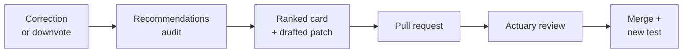

# From actuarial knowledge<br/>to trusted AI analytics

## Building the context layer, step by step, with nao

<div class="mt-12 opacity-70">
Stéphane Furderer · Actuarial Technology Summit · December 15, 2026<br/>
<span class="text-sm">All data in this talk is synthetic.</span>
</div>

---
layout: default
---

# "What was our 2025 loss ratio?"


<div class="text-center text-sm opacity-70">Same warehouse, SQL that runs both times. AY 2025, valued 2026-09-30, case incurred (no IBNR).</div>

<!--
[TP-01] What was our 2025 loss ratio? I asked that of a synthetic travel insurer I built for this talk, and I got two answers. 58.9 percent, and 49.9 percent. Both come from SQL that runs. Both look reasonable on a slide. The gap is three sentences that every actuary in this room knows: use earned premium, subtract recoveries, ignore the test partner. Today is about where those three sentences live, and how an AI analyst finds them before it answers.
-->

---
---

# The model is not the problem

<div class="grid grid-cols-2 gap-10 mt-6">
<div>

### Inferred from the data ✅
- code `40` = recovery *(reserves net to 0, recoveries don't)*
- partner `ZZTEST` = test data *(60 claims at \$9,999.99)*
- accident year = year of `loss_date`

</div>
<div>

### Conventions it had to guess ❌
- attritional: **cap** large claims, don't drop them
- frequency **per 1,000** policies
- ask before answering an ambiguous question

</div>
</div>

<div class="mt-10 text-xl">A guess that looks right is the dangerous kind: <b>39.3%</b> vs <b>41.6%</b>.</div>

<!--
[TP-02] I expected an AI to get this wrong. It didn't, mostly. I gave a model only the schema and the data. It worked out that code 40 is a recovery, because reserves net to zero and recoveries don't. It spotted the test partner from the round 9,999.99 claims. That's impressive. But on the questions that depend on *our* conventions (what we call a large loss, what attritional means, frequency per thousand), it guessed. And a guess that looks right is the dangerous kind.
-->

---
layout: two-cols
---

# A context layer is<br/>the new analyst's binder

- which premium, which year, which partner is fake
- written once, in plain words
- owned by a named actuary
- **read by the agent before every answer**
- tested like a model

::right::

```text
context/                  # a nao project = a folder
├── nao_config.yaml       # scope
├── RULES.md              # router + always-rules
├── semantics/            # one definition per metric
│   ├── loss_ratio.md
│   ├── claim_frequency.md
│   └── large_and_cat_losses.md
├── databases/…/table=claims/
│   ├── columns.md        # nao sync
│   ├── profiling.md      # nao sync
│   └── annotations.md    # you
└── tests/*.yml           # reference answers
```

<!--
[TP-03] Think about onboarding a brilliant new analyst. They know SQL on day one. What they don't know is us: which premium to use, what a large loss is, which partner is fake. So we hand them a binder. A context layer is that binder, kept as plain files in git, and the AI reads the relevant pages before every answer. Nao is an open-source analytics agent built around exactly that idea: the context is a folder you can read, review and test.
-->

---
layout: center
class: text-center
---

# 🎙️ Claire Gouze, CEO, nao Labs

### Why data teams should become context teams

---
---

# The sandbox: a synthetic travel insurer

| table | rows | grain |
|---|---:|---|
| `mart.policies` | 60,000 | policy, 4 partners + 1 test partner |
| `mart.earned_premium_monthly` | ~159k | policy × accounting month |
| `mart.claims` | ~4,200 | claim, `loss_date`, `cat_event_code` |
| `mart.claim_transactions` | ~13,700 | `txn_code` 10 / 20 / 40 |
| `mart.partners` | 5 | airline, OTA, cruise, direct, *ZZ* |

<div class="mt-6">Legacy-style codes · valued <b>2026-09-30</b> · one command: <code>make data</code></div>

<!--
[TP-04] Everything you'll see runs on synthetic data, so I can share all of it. It's a travel insurer: sixty thousand policies, about four thousand claims, sold through airlines, an online travel agency, a cruise line and direct. Like a real legacy system, transactions carry codes, not words: 10 is a payment, 20 a reserve change, 40 a recovery. It's valued at September 30, 2026. One command regenerates it, and the repo link is on the last slide.
-->

---
---

# Step 1: scope one question

```yaml
# context/nao_config.yaml
project_name: travel-actuarial
databases:
  - name: travel_warehouse
    type: duckdb
    include: [mart.*]          # gold / mart layer only
    exclude: [staging.*]       # raw feeds never reach the agent
    allow_listed_only: true    # SQL outside synced tables is blocked
    templates: [columns, preview, profiling]
```

**One question:** accident-year loss ratio. **Five tables.** nao's playbook: start with ≤ 20.

<!--
[TP-05] Step one is to be boring on purpose. Pick one question your team asks every quarter: the accident-year loss ratio. Give the agent only the clean mart tables that answer it, five here. Nao's own playbook says to start with no more than twenty. In the config I include the mart schema, exclude staging, and set allow-listed-only, so the agent can't query a raw feed even if it wanted to.
-->

---
---

# Step 2: `nao sync`: structure, not meaning

```bash
$ nao sync
✓ Sync Complete
  Databases: 5 tables across 1 datasets
```

`profiling.md` for `claim_transactions`:

```text
txn_code · distinct 3 · top values: "20" 8,102 · "10" 4,953 · "40" 666
```

<div class="text-xl mt-6">What is code <code>40</code>? The machine doesn't say.</div>

<!--
[TP-06] Step two is one command: nao sync. For every table it writes three markdown files: the columns, a few sample rows, and a profile of the values. This is what any agent sees out of the box. Notice what it says about code 40: nothing. It's a string with three values. The machine has the structure. It doesn't have the meaning.
-->

---
---

# Step 3: annotate the tables

```markdown

- Grain: one row per transaction. `txn_code` (legacy claims-system codes):
  - `10` = payment: money paid out (positive).
  - `20` = case reserve change: positive is an increase, negative is a release. The running sum is the outstanding case reserve.
  - `40` = recovery: money recovered from airlines or third parties. **Stored as a positive amount but reduces the loss**, so subtract it.
- Net incurred to date = SUM(code 10) + SUM(code 20) - SUM(code 40). Never a plain SUM(amount_usd).
- Transactions are valued as at 2026-09-30.
```

<div class="text-sm opacity-70">Hand-written, never overwritten by sync · owner: reserving actuary (CODEOWNERS)</div>

<!--
[TP-07] Step three is where actuaries come in. Next to each table, nao keeps an annotations file, plain markdown, that sync never overwrites. Here I write what each code means, the grain, and the pitfalls. Recoveries are stored positive but reduce the loss. Free-look cancellations earn nothing. ZZTEST is test data. Each line is something you'd tell a new hire in their first week. Now it's written down once, and the reserving actuary owns it.
-->

---
---

# Step 4: define each metric once

<div class="grid grid-cols-2 gap-8">
<div>

### `semantics/loss_ratio.md`
- **Loss ratio** = net incurred ÷ **earned** premium
- **Accident year** = `YEAR(loss_date)`, the default basis
- net incurred = code `10` + `20` − `40`
- `ZZTEST` out of numerator *and* denominator
- valued 2026-09-30, **no IBNR**: say so

</div>
<div>

### `semantics/large_and_cat_losses.md`
*Decisions, not facts*
- **Large loss** ≥ \$10,000 (our per-risk retention)
- **Cat** = any `cat_event_code` (HU25)
- **Attritional** = cat out, every other claim **capped** at \$10,000
- owner: reserving actuary

</div>
</div>

> "Each metric should have exactly one canonical definition." (nao docs, Rules)

<!--
[TP-08] Step four: define each metric once. The loss ratio file says net incurred over earned premium, accident-year basis, valued September 30, no IBNR. A second file holds decisions only we can make. A large loss is ten thousand dollars or more, our per-risk retention. Attritional means cat claims out and every other claim capped at ten thousand. Nao's docs are blunt here: two definitions of the same metric are the most common cause of inconsistent answers.
-->

---
---

# Step 5: `RULES.md` is a router, not an encyclopedia

```markdown
## Context map
- Metric definitions live in `semantics/`. **Read the file before computing the metric.** Each metric has exactly one definition; do not re-derive it.
  - Loss ratio, incurred, earned premium -> `semantics/loss_ratio.md`
  - Claim counts and frequency -> `semantics/claim_frequency.md`
  - Large losses, cat losses, attritional loss ratio -> `semantics/large_and_cat_losses.md`
- Per-table meaning, grain and pitfalls: `databases/.../table=<name>/annotations.md`. Read before filtering on a column.
- Value distributions: `profiling.md` next to each table.

## Always
- Exclude partner `ZZTEST` (QA test data) from every metric.
- Recoveries (`txn_code '40'`) reduce losses. Never a plain `SUM(amount_usd)` across transaction codes.
- Premium for any ratio is **earned** premium, never written.
- Free-look cancellations (`policy_status 'CX'`) are not policies in force.

## Clarify before analysing
Ask one short question when the metric, the period or the year basis (accident / report / underwriting) is missing and changes the answer. If the user gave a year but not a basis, use the default in the metric file and say which basis you used.

```

<!--
[TP-09] Step five is the rules file. It's loaded with every single message, so it stays short. It does three jobs. It routes: for a loss ratio, read this file. It states the always-rules: exclude the test partner, use earned premium. And it says when to ask: if someone says "the loss ratio" with no year or basis, the agent should ask one question instead of picking one. That last rule is how you get an analyst who knows what it doesn't know.
-->

---
layout: center
class: text-center
---

# 🎙️ Claire Gouze

### Context, data, model or query: how do you tell?

---
---

# Step 6: write the reference answers first

```yaml {maxHeight:'330px'}
# context/tests/attritional_loss_ratio_ay2025.yml
name: attritional_loss_ratio_ay2025
prompt: What was the 2025 attritional loss ratio?
sql: |
  WITH per_claim AS (
    SELECT c.claim_id,
           SUM(CASE t.txn_code WHEN '40' THEN -t.amount_usd ELSE t.amount_usd END) AS net_incurred
    FROM mart.claim_transactions t
    JOIN mart.claims c   USING (claim_id)
    JOIN mart.policies p USING (policy_id)
    WHERE YEAR(c.loss_date) = 2025 AND p.partner_code <> 'ZZTEST' AND c.cat_event_code IS NULL
    GROUP BY 1
  ), ep AS (
    SELECT SUM(e.earned_premium_usd) AS earned
    FROM mart.earned_premium_monthly e
    JOIN mart.policies p USING (policy_id)
    WHERE YEAR(e.accounting_month) = 2025 AND p.partner_code <> 'ZZTEST'
  )
  SELECT SUM(LEAST(net_incurred, 10000)) / MAX(earned) AS attritional_loss_ratio
  FROM per_claim, ep
```

<div class="text-sm">+ <code>ambiguous_loss_ratio.yml</code>: "What's the loss ratio?" passes only if the agent <b>asks a question back</b>.</div>

<!--
[TP-10] Step six is the one I'd keep if you forget everything else. Before you trust the agent, write the answer key. A nao test is a small YAML file: the question in plain English and the SQL the actuary signs off. Nao runs the agent, takes its final numbers, and compares them with your reference. I wrote nine, including one where the right behaviour is to ask a question back. One warning from the docs: never paste the answers into the context, or you're testing memory.
-->

---
---

# Step 7: run the tests, read the grid

<div class="text-sm">

| reference question | schema only (a) | schema only (b) | + annotations | full context (a) | full context (b) |
|---|:-:|:-:|:-:|:-:|:-:|
| loss ratio, by region, by coverage, earned, Caribbean monthly | ✅ | ✅ | ✅ | ✅ | ✅ |
| large losses (≥ \$10k) | ✅ *guessed* | ✅ *guessed* | ✅ | ✅ | ✅ |
| attritional loss ratio | ❌ 39.3% | ❌ 39.3% | ❌ 39.3% | ✅ 41.6% | ✅ 41.6% |
| frequency by region | ❌ 0.079 | ❌ 0.082 | ❌ 0.082 | ✅ 82.1 ‰ | ✅ 82.1 ‰ |
| "What's the loss ratio?" → ask | ✅ | ❌ answered | ✅ | ✅ | ✅ |
| **passed** | **7/9** | **6/9** | **7/9** | **9/9** | **9/9** |

</div>

<div class="text-xs opacity-60 mt-4">Blind Claude Sonnet analysts, one context level each, graded by evals/grade.py (mimics nao test). Synthetic data, small n. Not a production result.</div>

<!--
[TP-11] Then you run nao test, and you get a grid. I ran the same nine questions with blind AI analysts at three levels of context: schema only, plus annotations, plus definitions. Schema only passed six or seven of nine. With the full context, nine of nine, on both runs. The misses were all conventions. Attritional caps large claims; the blind agents dropped them, and got 39.3 instead of 41.6. Frequency is per thousand. And one agent answered when it should have asked. To be clear: this used my own grader on synthetic data, not a production claim.
-->

---
---

# Diagnose before you fix

<div class="grid grid-cols-4 gap-4 mt-8 text-center">
<div class="border rounded p-4"><h3>Context</h3><p class="text-sm">missing or ambiguous definition</p><p class="text-xs opacity-70">frequency "per 1,000"</p></div>
<div class="border rounded p-4"><h3>Data</h3><p class="text-sm">wrong or late data, bad model</p></div>
<div class="border rounded p-4"><h3>Query</h3><p class="text-sm">right definition, wrong SQL</p></div>
<div class="border rounded p-4 border-blue-500"><h3>Test</h3><p class="text-sm">the reference was ambiguous</p><p class="text-xs opacity-70">month as int vs date → fixed the test</p></div>
</div>

<div class="mt-10">Claire's own study: part of the 45% → 86% gain came from <b>fixing ambiguous tests</b>.</div>

<!--
[TP-12] A failing test doesn't automatically mean missing context. In my second run, the best-informed agent failed the Caribbean monthly question. Its numbers were right; it returned the month as a number and my reference returned a date. That was my test's fault, so I fixed the test, not the context. Claire found the same in her own study: part of the gain came from fixing ambiguous tests. So label every failure first: context, data, query, or test.
-->

---
---

# The investigation: all-in 49.9%, attritional 41.6%

<div class="grid grid-cols-2 gap-4 mt-2">


</div>

<div class="mt-4">Caribbean AY 2025: <b>95.7%</b> · trip-cancellation claims ~20 / month → <b>100</b> in August · tagged <code>HU25</code></div>

<!--
[TP-13] Now the fun part. The all-in loss ratio is 49.9 percent, but attritional is 41.6. Something big sits in the gap. By region, the Caribbean runs at 95.7 percent; everyone else is between 35 and 51. By loss month, Caribbean trip cancellations jump from about twenty a month to a hundred in August, and stay high through October. It's hurricane season, already tagged HU25 by the claims team. Every step shows its SQL.
-->

---
---

# Judgement stays with the actuary

<div class="grid grid-cols-2 gap-10 mt-8 text-lg">
<div>

### Found by the agent
- the spike, the region, the months
- every query, visible
- minutes, not weeks

</div>
<div>

### Decided by you
- one-off cat, or a trend to price?
- load for it? revisit the cruise partner?
- **then write the decision into the context**

</div>
</div>

<!--
[TP-14] Here's where I stop the agent. It found the spike in minutes and showed its work. It can't decide what the spike means. Is HU25 a one-off cat we load for, or a trend we should price into Caribbean trips? Do we revisit the cruise partner? Those are judgements with your name on them. What the context layer does is remember the decision once you make it, so the next person who asks gets your answer, not a fresh guess.
-->

---
---

# Close the loop: corrections become pull requests



<div class="mt-6">"YOLO mode" auto-opens PRs. For actuarial definitions: <b>off</b>.</div>

<!--
[TP-15] Context goes stale the day you ship it. Nao's answer is a feedback loop. It audits real usage on a schedule, including errors, downvotes and corrections, and ranks where the context is missing or wrong. Each recommendation shows the chats behind it and can open a pull request against the context repo. A human reviews it, merges it, and adds a test so it never regresses. There's an auto-merge mode. For actuarial definitions, I'd leave it off.
-->

---
---

# Ownership is the real deliverable

```text
# Who must approve changes to the context the agent reads.
# (GitHub handles are placeholders: replace with your team's.)
/context/semantics/loss_ratio.md               @reserving-actuary
/context/semantics/large_and_cat_losses.md     @reserving-actuary
/context/semantics/claim_frequency.md          @pricing-actuary
/context/databases/**/annotations.md           @reserving-actuary @data-engineering
/context/RULES.md                              @analytics-lead
/context/tests/                                @reserving-actuary @pricing-actuary
```

<div class="mt-4">Every pull request reruns the reference questions: <code>.github/workflows/context-tests.yml</code></div>

<!--
[TP-16] The technology is the easy part. The real deliverable is ownership. In this repo, a CODEOWNERS file says the reserving actuary approves any change to the loss ratio definition, and pricing owns frequency. Every pull request reruns the reference questions. That's the same governance we already apply to reserving models, applied to the words the AI reads. If nobody owns a definition, the agent will happily invent one.
-->

---
layout: center
class: text-center
---

# 🎙️ Claire Gouze

### Who owns the context, and how do you know it's getting better?

---
---

# Monday morning

1. **One bounded question** your team argues about
2. **Write what it means**, in plain words, with an owner
3. **Write the reference answer**: the SQL you would sign
4. **Test the agent** against it, before anyone else uses it

<div class="mt-10 opacity-80">nao suggests 20 tables and 20 questions. Start with one, and earn the next nineteen.</div>

<!--
[TP-17] If you want to start on Monday, do four things. One: choose one bounded question your team argues about. Two: write down what it means, in plain words, with an owner. Three: write the reference answer, the SQL you would sign. Four: test the agent against it before anyone else uses it. Nao suggests twenty tables and twenty questions. I'd start with one question and earn the next nineteen.
-->

---
layout: center
class: text-center
---

# The model is fast.<br/>Your definitions make it right.

<div class="mt-10 text-xl"><code>github.com/StephaneFurderer/nao-context-layer-actuaries</code></div>
<div class="mt-2 opacity-70">Synthetic data · rerun it · break it · tell me what you find</div>

<div class="mt-8 text-sm opacity-60">Sponsor acknowledgement slide: supplied by the organizer</div>

<!--
[TP-18] The models are already fast, and they're getting very good at SQL. What they will never have on their own is your institutional knowledge: which premium, which partner, which threshold, which year. A context layer is how that knowledge stops living in people's heads and starts being written, owned and tested. Everything I showed you is in this repository, on synthetic data. Rerun it, break it, and tell me what you find. Thank you.
-->
